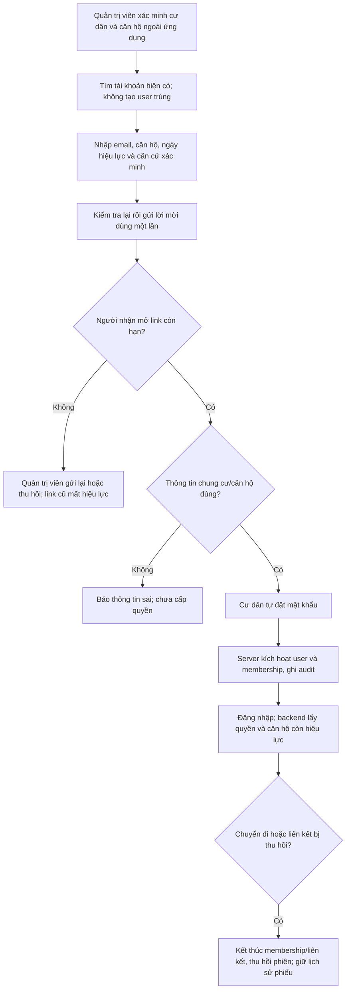
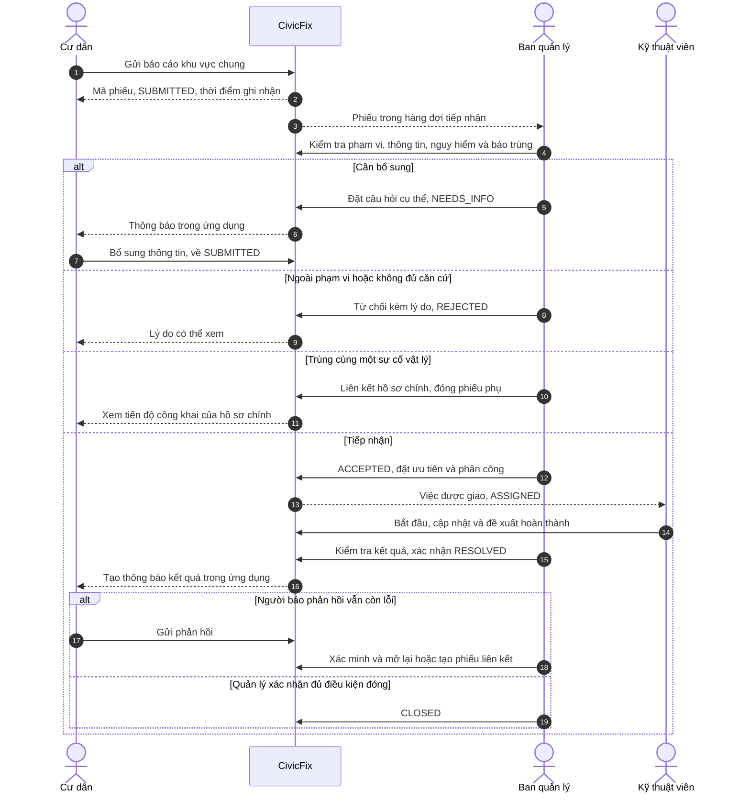
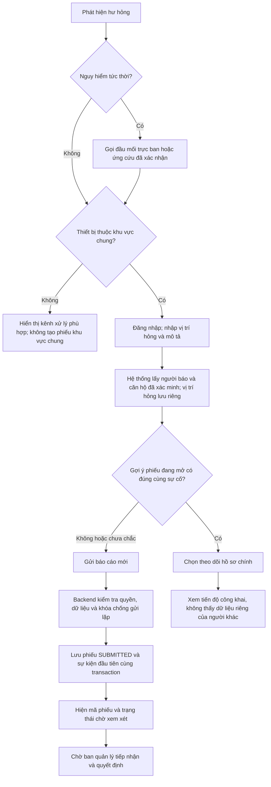
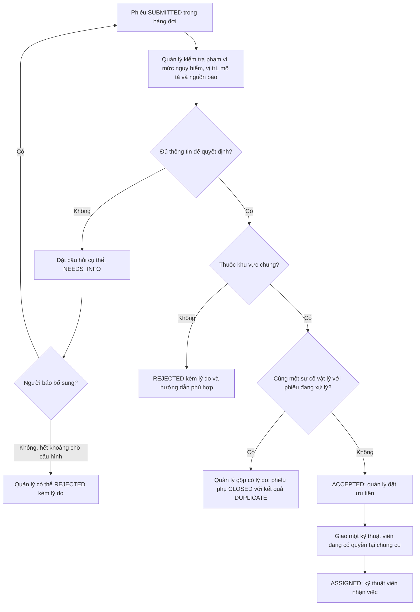
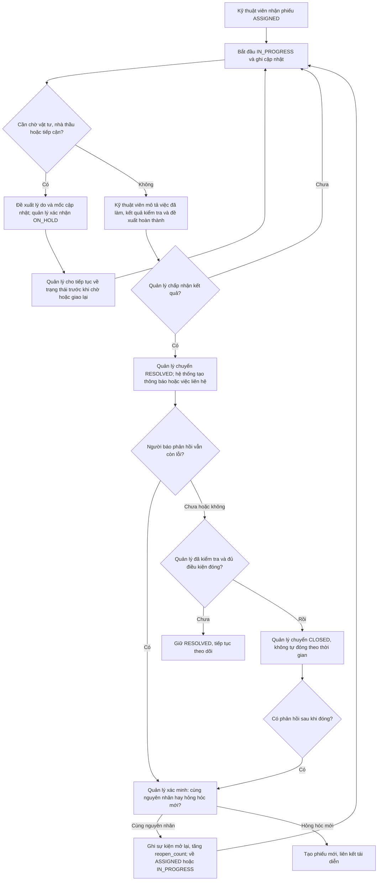
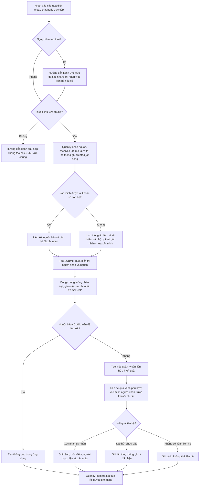

# Luồng nghiệp vụ CivicFix

**Phạm vi:** Bản web portfolio cho sự cố kỹ thuật ở khu vực chung của một chung cư. Các tình huống và thao tác liên hệ ngoài ứng dụng là mô phỏng. Sơ đồ này cụ thể hóa [PRD](PRD.md), không mô tả phần mềm đã triển khai.

## 0. Quản trị viên mời và kích hoạt tài khoản cư dân

Quản trị viên là người gắn căn hộ đã xác minh; xác nhận email chỉ chứng minh quyền kiểm soát hộp thư. Cư dân không tự chọn căn hộ hay role. Chi tiết trạng thái, khôi phục mật khẩu và xử lý lỗi nằm trong [vòng đời tài khoản](ACCOUNT_LIFECYCLE.md).

## 1. Bản đồ trách nhiệm từ báo cáo đến đóng phiếu

Thông báo trong ứng dụng chỉ xuất hiện khi người dùng mở web. Tạo thông báo không chứng minh người đó đã đọc. Ban quản lý là người xác nhận kết quả và quyết định mở lại; kỹ thuật viên chỉ **đề xuất hoàn thành**.

## 2. Cư dân tự báo qua web

- **Căn hộ người báo** dùng để đối chiếu danh tính. **Vị trí hỏng** là nơi cần sửa. Ví dụ cư dân căn 03 báo đèn hỏng ở hành lang trước căn 03; đây vẫn là sự cố khu vực chung. Ổ điện hoặc vòi nước riêng bên trong căn 03 nằm ngoài phạm vi bản đầu.
- Nếu tài khoản chưa có căn hộ được xác minh, vẫn nhận báo cáo và ghi “căn hộ chưa xác minh”. Không suy ra căn hộ từ mô tả vị trí. Nếu có nhiều căn hộ đã xác minh, cư dân chỉ chọn từ các căn hộ được liên kết với mình.
- Gợi ý trùng không tự gộp. Cư dân có thể tạo phiếu mới nếu đó là hư hỏng khác. Quyết định gộp/tách thuộc ban quản lý và phải có lý do.
- Cuộc gọi khẩn cấp là bước xử lý ngoài CivicFix; phiếu web không thay thế yêu cầu ứng cứu.

## 3. Ban quản lý phân loại và giao việc

Hệ thống không tự từ chối khi hết thời gian chờ và không tự gộp theo danh mục/tầng. Mỗi quyết định lưu người thực hiện, thời điểm và lý do. Việc gộp sai phải tách được, giữ lại lịch sử. Hai quản lý thao tác đồng thời cần được kiểm tra xung đột để không tạo hai người phụ trách chính.

## 4. Xử lý, báo kết quả và phản hồi

Nếu thu hồi hoặc chuyển việc, kỹ thuật viên cũ mất quyền cập nhật ngay. Mở lại là **sự kiện** chuyển về ASSIGNED/IN_PROGRESS, không phải một trạng thái REOPENED riêng. Với báo cáo ngoài web, điều kiện đóng còn phụ thuộc nhật ký liên hệ ở luồng 5.

## 5. Ban quản lý nhập hộ từ điện thoại, chat hoặc trực tiếp

Phiếu nhập hộ không được đóng khi việc liên hệ còn trống: cần ít nhất một lần liên hệ đã ghi nhận hoặc lý do không thể liên hệ. “Đã thử” khác “người báo xác nhận đã nhận”. Nếu người báo nói sự cố vẫn còn qua điện thoại/chat, quản lý ghi phản hồi và xử lý theo luồng mở lại. Bản portfolio không tự gọi điện hoặc gửi tin nhắn.

## 6. Những ranh giới phải giữ khi triển khai

| Ranh giới | Quy tắc cần kiểm tra |
|---|---|
| Dữ liệu người báo | Ban quản lý thấy tên và căn hộ của phiếu thuộc chung cư mình. Cư dân chỉ thấy dữ liệu của mình. Kỹ thuật viên chỉ thấy thông tin thật sự cần cho việc được giao. |
| Phiếu báo trùng | Người theo dõi phiếu chính chỉ thấy tiến độ và kết quả công khai; không thấy tên, căn hộ, ảnh riêng hoặc ghi chú nội bộ của người khác. |
| Căn hộ và vị trí | Căn hộ được xác minh tại thời điểm báo được lưu thành snapshot; thay đổi nơi ở về sau không sửa lịch sử. Vị trí hỏng là trường độc lập. |
| Chuyển trạng thái | Backend kiểm tra vai trò, chung cư, quyền trên từng phiếu và trạng thái hiện tại. Không cho client tự gán status hoặc người báo. |
| Lịch sử | Mỗi quyết định, phân công, tạm hoãn, kết quả, liên hệ và mở lại có actor, thời điểm và sự kiện lưu vết. |
| Thông báo | Phân biệt đã tạo, đã đọc, đã thử liên hệ và đã xác nhận nhận kết quả. Không suy diễn một mốc thành mốc khác. |

**Ba kịch bản để kiểm tra sơ đồ:** (1) Cư dân căn 03 báo đèn hành lang và cư dân khác báo trùng; (2) quản lý nhập hộ cuộc gọi về rò nước đường ống chung rồi ghi lần trả kết quả; (3) kỹ thuật viên báo sửa xong nhưng cư dân phản hồi lỗi vẫn còn, quản lý mở lại cùng phiếu. Đây là dữ liệu giả lập; quy trình và ngưỡng thời gian cần xác minh với đơn vị vận hành trước khi dùng thật.
