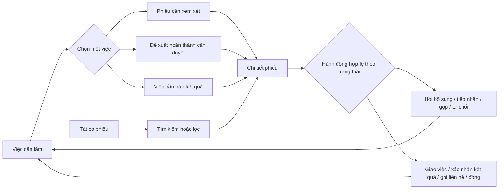
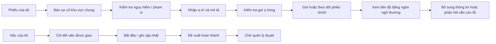

# Đề xuất luồng giao diện CivicFix — bản 2

**Mục đích:** Bản thiết kế để duyệt trước khi code. Ba vai trò nhìn thấy các trang khác nhau. Dữ liệu trong mockup là giả lập; quy tắc nghiệp vụ vẫn theo [PRD](PRD.md), [luồng M1](FLOWS.md) và [state machine](ACCEPTANCE_CRITERIA.md).

## 1. Vấn đề của prototype trước

1. **Tổng quan và Tiếp nhận cùng hiển thị phiếu**, khiến người quản lý không biết nên thao tác ở đâu.
2. **Bốn con số trạng thái và biểu đồ ngang kể cùng một chuyện.** Chúng chiếm chỗ mà không cho biết việc nào cần quyết định ngay.
3. **Danh sách hẹp nằm cạnh chi tiết phiếu** khiến tiêu đề/vị trí chật. Người dùng phải đọc hai vùng và ghi nhớ phiếu đang chọn.
4. **“Công việc”, “Tiếp nhận”, “Lịch sử” chồng nghĩa.** Công việc của kỹ thuật viên khác việc chờ quyết định của quản lý; lịch sử thuộc về từng phiếu.
5. **“Chờ xác nhận” không nói ai phải xác nhận.** Giao diện cần dùng tên tác vụ: “Quản lý cần duyệt kết quả”, “Cần báo kết quả cho người báo”.
6. **Phiếu nhập hộ bị giấu trong một nút trên màn chứa nhiều trạng thái.** Quản lý cần biết đây là một cách tạo phiếu, còn việc gọi lại sau giải quyết là một tác vụ riêng.

## 2. Kiến trúc thông tin theo vai trò

| Vai trò | Điều hướng chính | Câu hỏi màn đầu phải trả lời |
|---|---|---|
| Cư dân | Phiếu của tôi · Báo sự cố · Thông báo | Phiếu của tôi đã đến đâu, có cần tôi trả lời không? |
| Ban quản lý | Việc cần làm · Tất cả phiếu; nút Nhập hộ báo cáo | Tôi phải quyết định hoặc liên hệ về phiếu nào bây giờ? |
| Kỹ thuật viên | Việc của tôi | Việc nào được giao cho tôi và bước cập nhật tiếp theo là gì? |

“Lịch sử” là phần của **chi tiết phiếu**, không là mục điều hướng cấp cao. Trang báo cáo/thống kê chỉ thêm khi có câu hỏi vận hành cụ thể, dữ liệu đủ tin cậy và người dùng thật cần nó.

## 3. Luồng quản lý

### Trang “Việc cần làm”

- Là trang đầu của **ban quản lý**, sắp theo việc phải làm, không theo tất cả trạng thái.
- Các nhóm có dữ liệu mới hiện ra: **Tiếp nhận báo cáo**, **Giao người xử lý**, **Duyệt đề xuất hoàn thành**, **Báo kết quả cho người báo**, **Xem phản hồi vẫn còn lỗi**. Mỗi hàng có mã phiếu, vấn đề, vị trí, thời điểm và hành động cụ thể.
- Một hàng dẫn tới chi tiết phiếu đúng ngữ cảnh. Sau khi xử lý, hàng biến mất khỏi nhóm cũ và nhóm/số việc cập nhật. Không giữ nó trên trang đầu chỉ để đủ bố cục.
- Không có thẻ KPI lớn, biểu đồ phân bố trạng thái hoặc bản sao của danh sách tất cả phiếu. Có thể có một câu nhỏ “5 việc cần bạn xử lý” tính từ các nhóm hiện hành.
- Nếu không có việc: “Hiện không có việc cần bạn xử lý”; nút đi tới Tất cả phiếu. Không dùng bốn số 0.

### Trang “Tất cả phiếu”

- Danh sách **toàn chiều rộng**, một hàng là một phiếu. Hiển thị mã + tên sự cố, vị trí hỏng, trạng thái dễ hiểu, người phụ trách nếu có và lần cập nhật gần nhất.
- Tìm theo mã/từ khóa; lọc trạng thái trong **một** bộ lọc. Mặc định hiện toàn bộ phiếu đang mở. Không có cột chi tiết luôn mở ở bên phải.
- Với khoảng 10 phiếu mẫu, tất cả các hàng có thể thấy trong một trang desktop. Khi dài, danh sách cuộn và có phân trang/tải thêm sau ngưỡng thực tế; không bắt bấm “Xem toàn bộ” sau 4–8 hàng trên chính trang này.
- Bấm hàng mở **Chi tiết phiếu**. Quay lại giữ bộ lọc, từ khóa và vị trí cuộn.

### Trang “Chi tiết phiếu”

- Đầu trang: mã phiếu, tiêu đề, vị trí hỏng, trạng thái hiện tại, người phụ trách. **Căn hộ người báo** nằm trong khối thông tin người báo có quyền xem; không trộn với vị trí hỏng.
- Khối đầu tiên là **bước tiếp theo**, diễn đạt theo người đang đăng nhập và trạng thái. Ví dụ phiếu `SUBMITTED`: “Kiểm tra phạm vi và quyết định tiếp nhận”; hành động Tiếp nhận, Hỏi bổ sung, Đánh dấu trùng, Từ chối. Sau khi tiếp nhận, phiếu `ACCEPTED` chuyển sang việc **Giao người xử lý**; không buộc chọn kỹ thuật viên ở bước xét phạm vi.
- Một hành động chính mỗi lần. Các hành động có rủi ro hoặc cần lý do mở hộp thoại với thông tin bắt buộc; không đổi trạng thái chỉ bằng một cú bấm mơ hồ.
- Bên dưới là mô tả, ảnh được phép xem, lịch sử thời gian và các phản hồi. Lịch sử phân biệt ai đã làm gì, khi nào, qua kênh nào.
- Sau hành động: thông báo rõ kết quả, trạng thái mới và **việc tiếp theo**. Nếu xung đột thao tác, tải lại phiếu và giải thích thay đổi.

## 4. Luồng cư dân và kỹ thuật viên

- **Cư dân** không thấy queue quản lý, trạng thái nội bộ, danh tính người báo khác hoặc danh sách toàn chung cư. Sau khi gửi phải thấy mã phiếu và câu “Đã ghi nhận, đang chờ quản lý xem xét” — không tuyên bố đã tiếp nhận.
- **Kỹ thuật viên** chỉ thấy việc được giao. “Đề xuất hoàn thành” không gửi thông báo “đã sửa xong” cho cư dân trước khi quản lý duyệt.
- Người báo qua **điện thoại/chat** có thể không có tài khoản; khi phiếu được giải quyết, việc liên hệ nằm trong “Việc cần làm” của quản lý. “Đã thử liên hệ” và “người báo xác nhận đã nhận” là hai kết quả khác nhau.

## 5. Quy tắc hiển thị và chuyển màn

| Tình huống | Trang đầu quản lý | Trang Tất cả phiếu | Chi tiết phiếu |
|---|---|---|---|
| Báo cáo mới `SUBMITTED` | Nhóm Tiếp nhận báo cáo | Hàng trạng thái “Chờ xem xét” | Tiếp nhận / Hỏi bổ sung / Gộp / Từ chối |
| Đã tiếp nhận `ACCEPTED`, chưa phân công | Nhóm Giao người xử lý | “Đã tiếp nhận · Chưa phân công” | Chọn người phụ trách, xác nhận giao việc |
| `NEEDS_INFO` | Chỉ xuất hiện nếu có phản hồi mới cần quản lý xem | “Chờ người báo bổ sung” | Câu hỏi đã gửi và nội dung bổ sung |
| Kỹ thuật viên đề xuất hoàn thành | Nhóm Duyệt đề xuất hoàn thành | Vẫn thuộc “Đang xử lý” cho đến khi duyệt | Xem kết quả, duyệt hoặc trả lại có lý do |
| `RESOLVED`, người báo ngoài ứng dụng | Nhóm Báo kết quả | “Đã khắc phục · Chưa báo kết quả” | Ghi lần liên hệ; không tự đánh dấu đã nhận |
| Cư dân phản hồi vẫn còn lỗi | Nhóm Xem phản hồi | Nhãn “Có phản hồi mới” cạnh trạng thái | Xác minh, mở lại cùng lỗi hoặc tạo phiếu liên kết |

Các nhãn tác vụ ở trang đầu được suy ra từ **trạng thái + sự kiện/việc chờ xử lý**, không được lưu thành một trạng thái nghiệp vụ thứ hai. Bộ lọc và số việc dùng cùng nguồn dữ liệu, nên không thể lệch nhau.

## 6. Tiêu chí duyệt luồng trước khi code

1. Người quản lý mở web biết ngay **việc nào cần quyết định**, bấm một hàng tới đúng phiếu và hoàn thành được tác vụ; không phải hiểu biểu đồ trước.
2. Người quản lý tìm một phiếu cũ bằng mã/vị trí từ Tất cả phiếu, rồi quay lại mà không mất bộ lọc.
3. Cư dân hoàn thành báo cáo khu vực chung trên điện thoại bằng vị trí và mô tả; sau đó biết rõ phiếu mới chỉ được ghi nhận.
4. Kỹ thuật viên đề xuất hoàn thành; quản lý duyệt; cư dân nhận kết quả và có đường phản hồi nếu vẫn lỗi.
5. Phiếu nhập hộ được giải quyết tạo việc báo kết quả; quản lý không thể hiểu nhầm lần thử liên hệ là đã báo thành công.
6. Quản lý có thể tiếp nhận một báo cáo hợp lệ khi chưa biết ai sẽ xử lý; phiếu đó vẫn hiện trong hàng đợi giao việc và không bị bỏ quên.

## 7. Cách áp dụng UI UX Pro Max

Bộ gợi ý cho **dashboard vận hành, giao diện tối giản, mật độ cao** phù hợp với danh sách và hàng đợi tác vụ. Bản vẽ áp dụng nhịp hàng ổn định, nhãn trạng thái bằng chữ, điều hướng hai mục và ít chuyển động. Gợi ý về hero, CTA và số liệu trên màn đầu là mẫu cho landing page, không phù hợp với nhiệm vụ quản lý phiếu nên không áp dụng. Màu được giữ theo bản nhận diện CivicFix hiện tại để các màn hình nhất quán; không thay toàn bộ giao diện bằng bảng màu mẫu do skill trả về.

Khi code, cần kiểm tra bàn phím, focus, tương phản, nhãn biểu mẫu, phản hồi sau thao tác và cách danh sách chuyển sang màn hình hẹp. Mockup tĩnh chưa xác minh được các hành vi đó.

**Chưa được xác minh bằng người dùng thật:** ngưỡng ưu tiên, tần suất người quản lý mở web, kênh liên hệ và thời hạn phản hồi. Prototype chỉ kiểm tra tính nhất quán và mức dễ hiểu của luồng giả lập.
